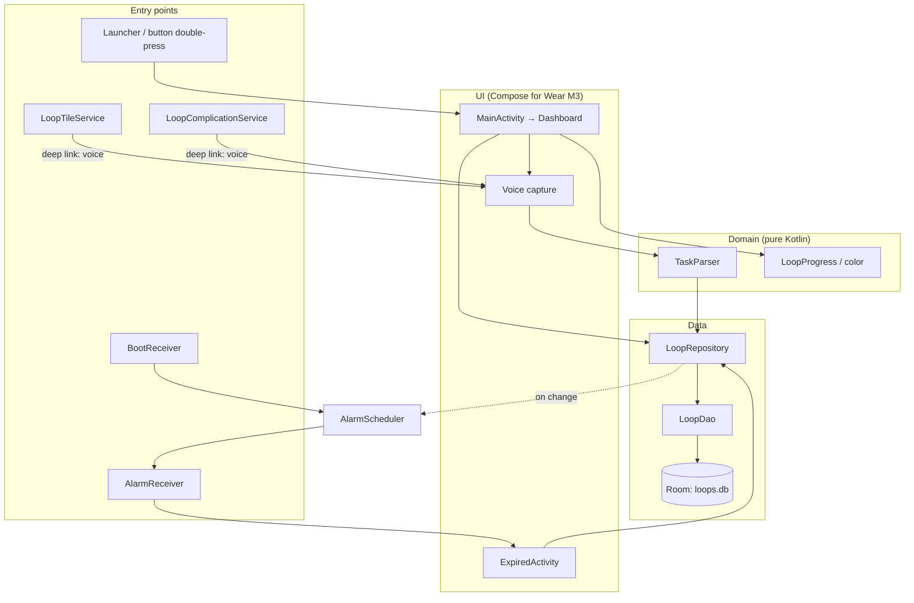
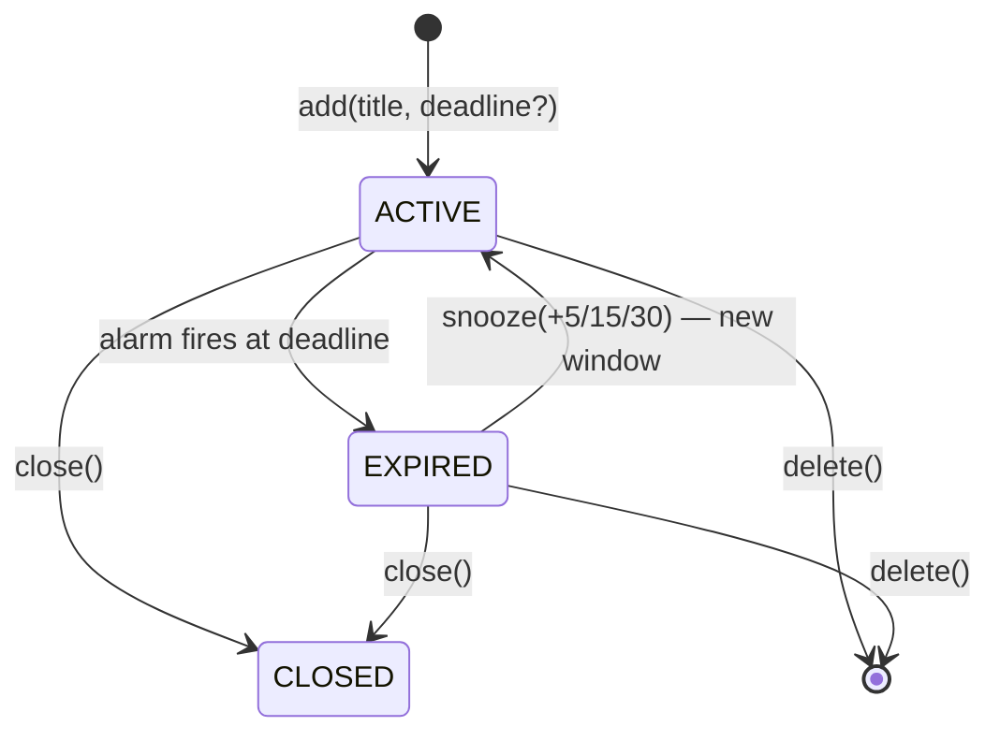

# ARCHITECTURE.md — CloseTheLoop

Product spec: [CLAUDE.md](CLAUDE.md). Agent rules: [AGENTS.md](AGENTS.md).

## Overview
Single-module, single-activity Wear OS app. Layers depend downward only:



## Modules & packages (`com.closetheloop`)
`:shared` (Android library) holds everything platform-neutral; `:wear` (watch app) and `:mobile` (phone app) depend on it. Both apps keep `applicationId = com.closetheloop`; each has its own local DB until cloud sync lands.

| Module | Package | Contents | Status |
|---|---|---|---|
| `:wear` | root | `CloseTheLoopApp` (Application), `AppContainer` (manual DI), `MainActivity` | ✅ |
| `:shared` | `data` | `Loop` entity, `LoopStatus`, `LoopDao`, `LoopDatabase`, `LoopRepository`, `LoopScheduler` (interface) | ✅ |
| `:shared` | `parser` | `TaskParser` — text → `ParsedTask(title, deadline?)` | ✅ |
| `:shared` | `domain` | `LoopProgress` (fraction, `Urgency` bands, ring selection), `ExpiryPolicy` (alarm decisions, re-buzz, snooze options), `LoopSummaries.mostUrgent` (Tile/Complication content) — pure Kotlin | ✅ |
| `:shared` | `ui` | `TimeFormat`, `LoopRings` + `LoopColors` (Compose Canvas rings, per-task palette), `MainViewModel` (+ `Factory` via `LoopApp`) | ✅ |
| `:shared` | `voice` | `VoiceCapture` — in-app `SpeechRecognizer` (state: Idle/Listening/Heard/Failed) | ✅ |
| `:shared` | root | `LoopApp` — interface each Application implements: `repository`, `scheduler`, `expiredScreenIntent(loopId)` | ✅ |
| `:shared` | `domain` | `QuickTime` presets (15 min … Tomorrow / No time) resolved via `TaskParser` | ✅ |
| `:wear` | `ui` | `MainScreen` (routes: listening / saved / error / dashboard; edit target for voice/keyboard edits), `DashboardScreen` (hero + Upcoming + Long-term + Close / Edit by voice / Edit by typing / Delete dialog), `Theme` | ✅ |
| `:mobile` | root | `CloseTheLoopPhoneApp` (`LoopApp`, local Room DB, `LoopAlarms`), `MainActivity` (edge-to-edge) | ✅ |
| `:mobile` | `ui` | `PhoneExpiredActivity` (M3 Time's-up screen over lock screen: pulsing red ring, Close Loop, +5/15/30) | ✅ |
| `:mobile` | `notify` | `LiveCountdownNotifier` — pinned countdown for the soonest ticking loop (`LiveCountdowns.select` in `:shared`). API 36: `Notification.ProgressStyle` in the loop color + countdown chronometer + `android.requestPromotedOngoing` extra (Live Update: status-bar chip / Now Bar; needs `POST_PROMOTED_NOTIFICATIONS`). Older: NotificationCompat progress. Refreshed by `CloseTheLoopPhoneApp` on loop changes and every minute. Actions: Close Loop / +15 min. | ✅ |
| `:mobile` | `ui` | `PhoneTheme` (always-dark M3, loop-green), `PhoneScreen`: header (date, "✓ N closed today"), ring hero, Time's up / Upcoming / Long-term cards with progress bars, swipe-right to close + Undo, add bar (composer + instant Mic), composer sheet with live parse preview + `QuickTime` chips + dictate-into-field, actions sheet (Close / +5/15/30 / Edit / Delete) | ✅ |
| `:shared` | `alarm` | `LoopAlarms` (`LoopScheduler` impl, `setAlarmClock`), `AlarmReceiver` (fire / close / snooze), `BootReceiver`, `ExpiryAlert` (full-screen notification + buzz) — declared in the shared manifest, merged into both apps; reach app services via `context.loopApp` | ✅ |
| `:wear` | `alarm` | `ExpiredActivity` (wear Compose Time's-up screen) | ✅ |
| `:wear` | `tile` | `LoopTileService` — raw ProtoLayout (Arc ring + title + remaining + Mic `LaunchAction` with `START_VOICE`) via `SuspendToFutureAdapter` | ✅ |
| `:wear` | `complication` | `LoopComplicationService` (`RANGED_VALUE`) | deferred |

## Dependency injection
Manual. `CloseTheLoopApp.onCreate()` builds one `AppContainer` (database, `scheduler: LoopScheduler = LoopAlarms`, `repository`); anything with a `Context` reaches it via `context.appContainer`. The repository owns scheduling: `add` arms, `snooze` cancels + re-arms, `close`/`delete` cancel (alarm + notification).

## Data model
```
Loop(
  id, title, createdAt,
  deadline: Long?           // null = long-term to-do
  originalDurationMs: Long?,
  status: ACTIVE | EXPIRED | CLOSED,
  snoozeCount, lastSnoozedAt: Long?, closedAt: Long?,
  syncId: String (UUID, unique)  // shared across devices; `id` is device-local
  updatedAt: Long                // last user change, last-write-wins
  deleted: Boolean               // tombstone until the deletion is uploaded
  dirty: Boolean                 // changed locally, not yet uploaded
)
windowStart = lastSnoozedAt ?: createdAt
progress    = (deadline - now) / (deadline - windowStart)   // 1 → 0
```
- "Open" = status ≠ CLOSED and not deleted. Sorted: deadline ASC, then long-term newest-first.
- Enums are stored as their names (Room default). DB **version 2**; `MIGRATION_1_2` adds the sync columns (existing rows get a random syncId, `updatedAt = closedAt ?: lastSnoozedAt ?: createdAt`, and are dirty so they upload on first sync). Tested in `LoopMigrationTest`.

## Sync model (stage A: local side)
- Every user change (add/close/snooze/reopen/edit/delete) bumps `updatedAt` and sets `dirty`. `delete` writes a tombstone.
- `markExpired` is alarm-driven and derivable on any device, so it stays local (no `updatedAt`, not dirty).
- `pendingUploads()` / `observePendingUploads()` → `RemoteLoop`s to push; `markUploaded(remote)` clears dirty only if no newer local edit happened (`WHERE updatedAt = :uploaded`) and purges uploaded tombstones.
- `applyRemote(remote)`: last-write-wins on `updatedAt`; remote tombstone deletes the row; keeps a local EXPIRED status when only non-timing fields changed; re-arms or cancels alarms (cancel also dismisses a Time's-up alert) when deadline/status changed.
- Stage B (Firestore transport) and C/D (auth on phone → watch) build on this.

## Sync transport (stages B–D)
- `LoopSync` (`:shared/sync`) runs in each app's Application scope. On Firebase sign-in it listens to `users/{uid}/loops` (snapshot listener → `applyRemote`, skipping per-document pending writes) and uploads `observePendingUploads()` with `set(doc)` → `markUploaded`. Stops on sign-out. Rules: [firestore.rules](firestore.rules) (owner-only).
- **Phone sign-in:** `GoogleAccount` (Credential Manager `GetSignInWithGoogleOption` → Google ID token → `FirebaseAuth.signInWithCredential`). Account sheet shows status, *Connect watch*, Sign out.
- **Watch sign-in handoff:** phone `WatchBridge` puts the ID token on the Wear Data Layer at `/closetheloop/auth` (urgent). Watch `AuthListenerService` (`DATA_CHANGED`, `wear://*/closetheloop`) signs into Firebase as the same user, then deletes the data item. Sign-out is propagated the same way. Needs the phone↔watch Bluetooth link (items queue until connected). ID tokens expire in ~1 h, so *Connect watch* sends a fresh one.
- **Known limit:** Android 16 / Wear OS 6 block network for backgrounded apps (`blocked=APP_BACKGROUND`), so each device syncs while its app is open (queued changes flush then). Background sync is a follow-up.
- Verified 2026-10-24: phone and watch DBs identical (36 loops, none dirty) after handoff.

## Loop lifecycle

Long-term loops (no deadline) stay ACTIVE until closed/deleted; they never get an alarm. Only loops still counting down get a bezel ring; expired loops show "Time's up" in the hero but no ring.

## Dashboard layout
- `LoopTheme` (wear M3 `ColorScheme` with loop-green primary) wraps `MainActivity` and `ExpiredActivity`.
- No ambient/AOD mode by choice: when the screen dims the system returns to the watch face.
- Haptics: `HapticFeedbackType.Confirm` on Close Loop (dashboard dialog and Time's-up screen).
- `ScalingLazyColumn` centered on the hero (item 0); rings are drawn on top as a fixed overlay so the "loop" stays on the bezel while scrolling.
- Rings: one per ticking loop (no cap). Stroke = `29dp / (1.5n − 0.5)` clamped to 1.2–7 dp, gap = stroke/2. Color = `LoopColors.forLoop(id)` (8-color palette by id); `Urgency.CRITICAL` (<20%) → red + alpha pulse (infinite transition only when a critical ring exists).
- Content is inset by `ringsInset(n)`; TimeText and the scroll indicator are hidden while rings are visible.
- UI clock ticks every 1s only while the activity is RESUMED (`repeatOnLifecycle`).

## Key flows
- **Capture:** Mic → `VoiceCapture` (in-app `SpeechRecognizer`, default service = Google; the `RecognizerIntent` activity shows a chooser on Galaxy Watch, so it's avoided) → `TaskParser.parse(text, now, zone)` → `repository.add()` → scheduler arms alarm if deadline. `MainActivity` extra `START_VOICE=true` opens straight into listening.
- **Edit:** loop dialog → "Edit by voice" (same `VoiceCapture`, routed via `editTarget`) or "Edit by typing" (`RemoteInputIntentHelper` → system keyboard/handwriting) → `MainViewModel.edit` re-parses. No time in the text → title only (deadline + alarm untouched); new time → `repository.edit` restarts the window (`lastSnoozedAt = now`), reactivates, and re-arms.
- **Expiry:** `setAlarmClock` alarm (per-loop `PendingIntent`, requestCode = id) → `AlarmReceiver.ACTION_FIRE` → `ExpiryPolicy.onAlarm(loop, now)`:
  - `Cancel` (closed/deleted/long-term) → disarm; `Wait(at)` (fired early, e.g. after snooze) → re-arm;
  - `Buzz` → mark EXPIRED (first time), re-arm `now + 3 min`, `ExpiryAlert.show` (re-posts the full-screen notification so `ExpiredActivity` wakes the screen, plus a `USAGE_ALARM` waveform buzz).
  - Notification actions (Close Loop / +5 / +15 / +30) go to `AlarmReceiver` → repository. `ExpiredActivity` observes its loop and finishes once it's no longer EXPIRED.
  - Expiry and live-countdown notifications are `setLocalOnly(true)`: each device alerts for itself, so the phone's alerts don't bridge to the watch as a second buzz.
- **Permissions:** `USE_EXACT_ALARM` (API 33+, auto-granted; `SCHEDULE_EXACT_ALARM` ≤ 32), `USE_FULL_SCREEN_INTENT` (granted on the API 36 test watch), `POST_NOTIFICATIONS` (requested on first launch), `VIBRATE`, `RECEIVE_BOOT_COMPLETED`.
- **Reboot/update:** `BootReceiver` (`BOOT_COMPLETED`, `MY_PACKAGE_REPLACED`) → `openWithDeadline()` → `ExpiryPolicy.rearmAt` (overdue loops re-fire after 5 s).
- **Surfaces:** Tile (+ Complication, step 8) render `LoopSummaries.mostUrgent(openLoops, now)`. `CloseTheLoopApp` collects `observeOpen()` in an app scope and calls `LoopTileService.requestUpdate` on every change; the tile also sets a 60 s freshness interval. Ring only while ticking; expired → "Time's up" in red.
- **Tile debugging:** `$ADB shell am broadcast -a com.google.android.wearable.app.DEBUG_SURFACE --es operation add-tile --ecn component com.closetheloop/.tile.LoopTileService`, then `... DEBUG_SYSUI --es operation show-tile --ei index 0`. Errors log under tag `TileService`.

## Testing
| Layer | Approach | Location |
|---|---|---|
| Data | Robolectric (SDK 34) + in-memory Room, fake clock | `shared/src/test/.../data` |
| Parser / progress | Plain JUnit, fixed clock + `ZoneId` | `shared/src/test/...` |
| UI, alarms, tile, complication | Manual on Galaxy Watch 7 via wireless adb | — |

## Build config
- [gradle/libs.versions.toml](gradle/libs.versions.toml) — all versions
- [shared/build.gradle.kts](shared/build.gradle.kts) — Android library: Room (KSP, exposed as `api`), parser, domain, tests
- [wear/build.gradle.kts](wear/build.gradle.kts) — watch app: Compose for Wear, Tiles, wear-input; depends on `:shared`
- Manifest: `uses-feature android.hardware.type.watch`, `com.google.android.wearable.standalone=true`
