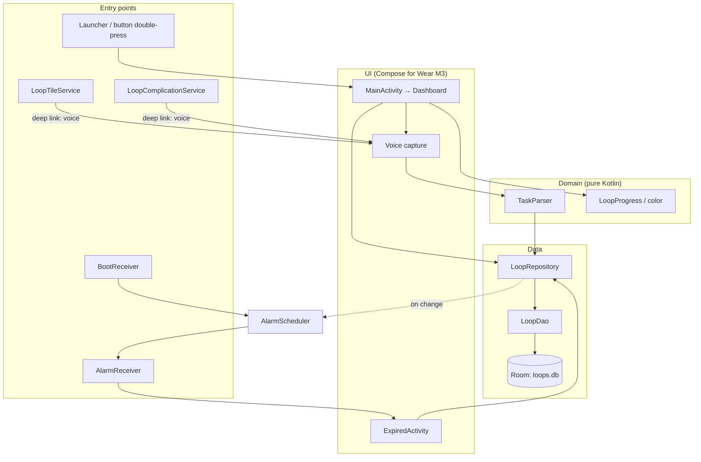
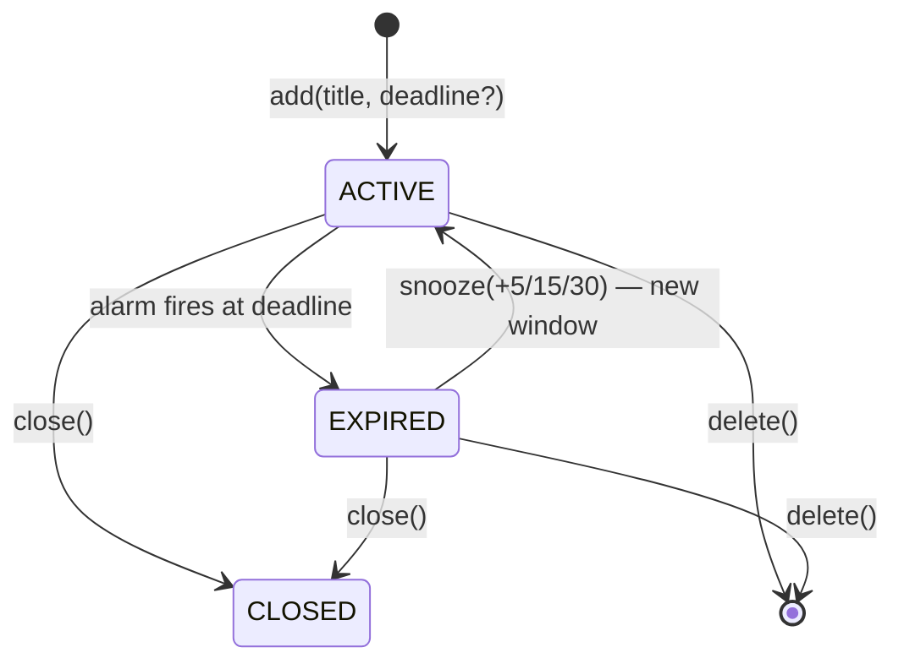

# ARCHITECTURE.md — CloseTheLoop

Product spec: [CLAUDE.md](CLAUDE.md). Agent rules: [AGENTS.md](AGENTS.md).

## Overview
Single-module, single-activity Wear OS app. Layers depend downward only:



## Packages (`com.closetheloop`)
| Package | Contents | Status |
|---|---|---|
| root | `CloseTheLoopApp` (Application), `AppContainer` (manual DI), `MainActivity` | ✅ |
| `data` | `Loop` entity, `LoopStatus`, `LoopDao`, `LoopDatabase`, `LoopRepository` | ✅ |
| `parser` | `TaskParser` — text → `ParsedTask(title, deadline?)` | ✅ |
| `voice` | `VoiceCapture` — in-app `SpeechRecognizer` (state: Idle/Listening/Heard/Failed) | ✅ |
| `ui` | `MainViewModel`, `MainScreen` (home, listening, saved, error), `TimeFormat` | partial (dashboard rings: step 5) |
| `alarm` | `AlarmScheduler`, `AlarmReceiver`, `BootReceiver`, `ExpiredActivity`, notifications | step 6 |
| `tile` | `LoopTileService` (ProtoLayout) | step 7 |
| `complication` | `LoopComplicationService` (`RANGED_VALUE`) | step 8 |

## Dependency injection
Manual. `CloseTheLoopApp.onCreate()` builds one `AppContainer`; anything with a `Context` reaches it via `context.appContainer`. Add new singletons (scheduler, parser) to `AppContainer`.

## Data model
```
Loop(
  id, title, createdAt,
  deadline: Long?           // null = long-term to-do
  originalDurationMs: Long?,
  status: ACTIVE | EXPIRED | CLOSED,
  snoozeCount, lastSnoozedAt: Long?, closedAt: Long?
)
windowStart = lastSnoozedAt ?: createdAt
progress    = (deadline - now) / (deadline - windowStart)   // 1 → 0
```
- "Open" = status ≠ CLOSED. Sorted: deadline ASC, then long-term newest-first.
- Enums are stored as their names (Room default). DB version 1, no migrations yet (`exportSchema = false`).

## Loop lifecycle

Long-term loops (no deadline) stay ACTIVE until closed/deleted; they never get an alarm.

## Key flows
- **Capture:** Mic → `VoiceCapture` (in-app `SpeechRecognizer`, default service = Google; the `RecognizerIntent` activity shows a chooser on Galaxy Watch, so it's avoided) → `TaskParser.parse(text, now, zone)` → `repository.add()` → scheduler arms alarm if deadline. `MainActivity` extra `START_VOICE=true` opens straight into listening.
- **Expiry:** exact alarm → `AlarmReceiver` → `markExpired` → full-screen `ExpiredActivity` + ongoing notification + buzz → re-arm buzz alarm every 3 min until close/snooze.
- **Reboot/update:** `BootReceiver` → `repository.openWithDeadline()` → re-arm all.
- **Surfaces:** Tile + Complication read the most urgent open loop; refreshed on repository change and every minute.

## Testing
| Layer | Approach | Location |
|---|---|---|
| Data | Robolectric (SDK 34) + in-memory Room, fake clock | `app/src/test/.../data` |
| Parser / progress | Plain JUnit, fixed clock + `ZoneId` | `app/src/test/...` |
| UI, alarms, tile, complication | Manual on Galaxy Watch 7 via wireless adb | — |

## Build config
- [gradle/libs.versions.toml](gradle/libs.versions.toml) — all versions
- [app/build.gradle.kts](app/build.gradle.kts) — Android config, KSP (Room), test options
- Manifest: `uses-feature android.hardware.type.watch`, `com.google.android.wearable.standalone=true`
